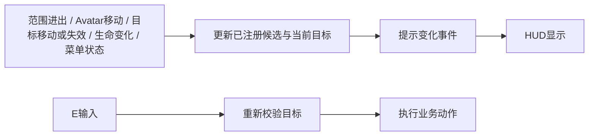

# 事件驱动的场景交互

规则依据为[规格](../.scratch/wizard-demo/spec.md) R01/R03/R04/R06；本轮将炼金台接入提炼成可供商店复用的模块，不实现商店交易。

## 职责与接口

- `UWizardInteractionComponent` 归 PlayerState，持有当前 Avatar、弱引用候选、当前目标与提示。对输入提供 `TryInteract()`，对HUD提供初始 `GetPrompt()` 和 `OnPromptChanged`。目标变更也会广播，即便提示文字相同；完全相同的目标/文字不重复广播。
- `UWizardInteractionTarget` 是无Tick的球形查询范围，配置可视对象、距离和提示，原生 `Condition` / `Action` 委托接入业务。它统一检查引用、存活、精确水平距离与Visibility遮挡；业务的额外限制放在Condition。
- `AWizardAlchemyStation` 作为炼金台适配，仅配置原有Camp_Alchemy、250cm距离、营地条件与打开技能页的动作。原模型和营地盒体不移动。技能搭配提交从已注册候选重新验证炼金台权限，不依赖当前HUD提示是否隐藏。
- Controller的E输入只调用通用入口。独立`UWizardInteractionPrompt`订阅提示事件，在交互物模型上方显示；技能栏不再持有交互提示，0.1秒刷新只用于技能冷却数字。
- 提示文字、目标与显示资格由事件更新。界面每帧仅投影已选目标的可见Mesh包围盒八个角，取屏幕顶部居中，叠加间距；不扫描候选或查询遮挡。目标提供`GetPromptWorldBounds()`，排除交互球和其他非模型组件，可配置`PromptHeightOffset`。镜头移动/分辨率/DPI变化由投影适配；屏幕后方或屏外锚点隐藏，不吸附到屏幕边缘。布局和样式来自`WBP_InteractionPrompt`，文字不接受点击。

## 事件与生命周期

- BeginOverlap/EndOverlap注册和移除候选。球形范围仅作宽阶段；精确距离仍按原规则使用水平中心距离，避免胶囊尺寸把实际交互距离扩大。
- BindAvatar仅对当前Pawn已有重叠做一次初始化，覆盖出生或重生时已在范围内。移动/传送通过根组件TransformUpdated更新；只有旋转而位置不变时不重新查询。
- 多目标选择最近的有效目标；距离完全相同时用对象路径稳定排序。范围外、遮挡、死亡或失效目标不可执行。
- 打开菜单隐藏提示并禁止再次交互，关闭后从当前候选恢复。菜单中的业务提交仍可检查交互权限。
- Avatar解除/销毁和PlayerState结束时解除移动与目标委托；目标/可视对象销毁或禁用主动通知。候选和当前目标使用弱引用。

## 商店接入约定

在商人NPC Actor中创建同一个目标组件，在BeginPlay绑定原生Condition/Action，再调用InitializeTarget传入NPC自身、距离和提示。Action打开商店CommonUI，购买/出售通过T07物品事务；无需改E输入、HUD或添加交互轮询。

2026-11-01 用户明确：商店Actor本身为商人NPC，InitializeTarget的目标为this，NPC蓝图配置BattleWizardPBR模型、PBRMaskTintMat3Inst材质及待机动画；不引用房屋作为交互目标。商店提示、250cm范围与有效性检查随NPC自身更新，交易前仍重验权限。

商店关闭、营业条件变化等通过`SetInteractionEnabled`或`NotifyAvailabilityChanged`主动刷新。未来动态门/障碍改变遮挡时也应显式发出可用性变化通知；静态场景遮挡由移动事件重验，E按下时始终再次校验，因此陈旧提示不会授权无效动作。模块不扫描任意Actor来侦测未声明的外部变化，也不使用定时器补偿。

## 验证

提示的文本保留在`PromptText`，外层`PromptFrame`提供半透明深色背景与内边距。C++对整个框体更新位置和显隐，文字与背景一起出现/隐藏；两者均不接受点击。小范围样式修改按验证流程使用编辑器编译和PIE预览，不逐次重打Windows包。

`Wizard.Interaction.EventsAndLifetime`在真实碰撞世界验证范围事件、两种业务动作共用入口、最近选择、提示去重、菜单抑制、生命变化、目标销毁/启用和范围内重绑。`Wizard.Skills.TargetsAndCampTransactions`验证炼金台业务接入、营地限制及失败不提交。PIE/成品验证另外记录，接口测试不替代真实键盘输入。
